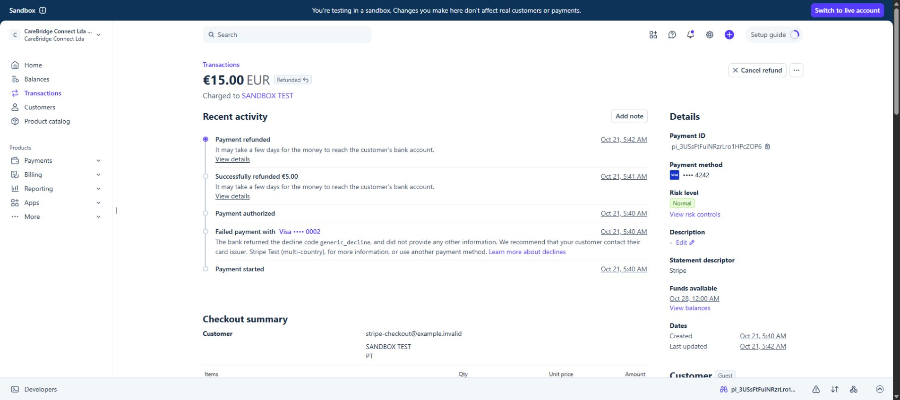
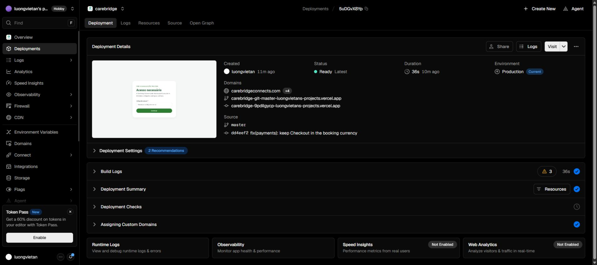
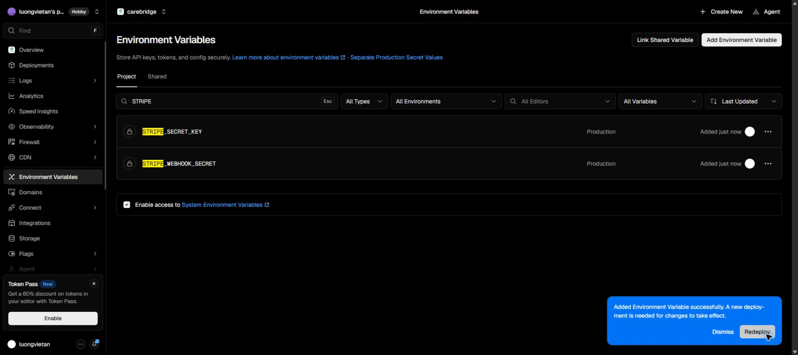

# Stripe sandbox integration — 21 October 2026

## Configuration

- Stripe sandbox: `acct_1UE8I3FuiNRzrLro` (Portugal, EUR).
- Production Vercel project: `carebridge`. Both Stripe variables are stored as Secrets with user approval.
- Enabled test webhook: `we_1USrpKFuiNRzrLroQ8OVXLE4`, `https://www.carebridgeconnect.co.uk/api/stripe/webhook`.
- Live account activation is outside this sandbox release. The private production gate remains enabled.
- Fresh database backup saved in the ignored operations directory before migrations 0099 and 0100.

## Implementation

- Durable Checkout session and stable idempotency key per payment, ownership and amount checks, and safe session reuse/replacement. Adaptive Pricing is explicitly disabled so Stripe charges the booking's snapshotted currency.
- Transactional webhook claim, payment lock, identity/currency/amount validation and audit.
- Declines remain retryable. A browser return does not declare payment success.
- Audited admin refund reservations, stable provider refund key and payout hold.
- Individual refund ledger handles dashboard refunds, partial/full refunds, duplicate delivery and asynchronous failure after apparent success.
- Payout amounts display the stored currency. Existing manual bank payout workflow is retained.
- Portuguese and English messages follow the saved language.

## Local verification

- Production build: passed (Next.js 16.3.8).
- TypeScript and ESLint: passed.
- Final CI application test run: 573 Vitest tests plus 9 Node tests passed.
- Latest focused payment/UI run: 28 passed.
- PostgreSQL WASM migration tests: 25 passed.
- React Doctor changed scope: no new issues, score 89/100.

## Deployment and integration gates

- Application release: `dd4eef25090eb92611922c4717b95851df8a585c` on `master`.
- [Production deployment](https://vercel.com/luongvietans-projects/carebridge/5uDGvX8YpG2C9VEm3HPHZG2zZBfY): Ready.
- [Final CI](https://github.com/luongvietan/carebridge/actions/runs/39550636848): passed, including 224 pgTAP assertions across 48 files and 70 E2E tests.
- Hosted Supabase migration history matches local through 0100.
- The new E2E cases exercise a decline followed by concurrent delivery of one success, one receipt, refund reservation, payout hold, refund failure and stale success delivery against the complete PostgreSQL schema.
- The commit hook printed a staged React Doctor notice; the follow-up scan of all 19 changed files reported no issues, score 89/100. No rule was suppressed.

## Actual Stripe sandbox verification

All identities and bookings below are labelled synthetic. No real card or care visit was used.

| Scenario | Verified result |
| --- | --- |
| Repeated Pay action | Same stored Checkout URL returned twice |
| Expired session | Actual Stripe expiration webhook closed the old attempt; a replacement was created |
| Checkout currency | EUR 15.00, `adaptive_pricing.enabled=false` |
| Declined card | Checkout displayed decline; database stayed pending |
| Retry in same session | Successful payment used the same PaymentIntent, `pi_3USsFtFuiNRzrLro1HPcZOP6` |
| Receipt | Exactly one application receipt record for that booking |
| Partial refund | EUR 5.00 reconciled through the real webhook |
| Remaining balance | Admin action refunded EUR 10.00; Stripe and database show EUR 15.00 refunded |
| Event replay | Four concurrent signed replays returned `duplicate`; one success audit and receipt remained, refunded status preserved |
| Refund later fails | Separate Stripe `pm_card_refundFail` transaction changed from apparent refund success to failure; database restored succeeded payment, zero refunded balance and released hold |
| Repay after refund | Application refused a new charge for the fully refunded booking |

Receipt delivery is recorded as queued in the existing email transport configuration; an outbound email delivery was not claimed by this payment verification.

Evidence: [provider results](stripe-2026-10-21/provider-results.json), [replay](stripe-2026-10-21/replay.json), [asynchronous failure](stripe-2026-10-21/async-refund-failure.json), [cleanup](stripe-2026-10-21/cleanup.json), [final checks](stripe-2026-10-21/final-checks.json).

Eight synthetic accounts (including accounts from interrupted fixture setup) were banned and suspended, the verification admin was demoted, and both future test bookings were cancelled. Financial test records remain available for audit.

## Scope remaining for real money

This release uses the expressly approved sandbox key. Switching to real funds requires separate live Stripe account activation and live keys/webhook configuration. The sandbox account reports `charges_enabled=false`, `payouts_enabled=false`, and `details_submitted=false`; test Checkout nevertheless succeeded. No business identity or bank details were invented or submitted.

Provider references: [Checkout fulfillment](https://docs.stripe.com/checkout/fulfillment), [webhooks](https://docs.stripe.com/webhooks), [idempotency](https://docs.stripe.com/api/idempotent_requests), [refunds](https://docs.stripe.com/refunds), [asynchronous refund test cards](https://docs.stripe.com/testing#refunds), [Checkout parameters](https://docs.stripe.com/api/checkout/sessions/create).
